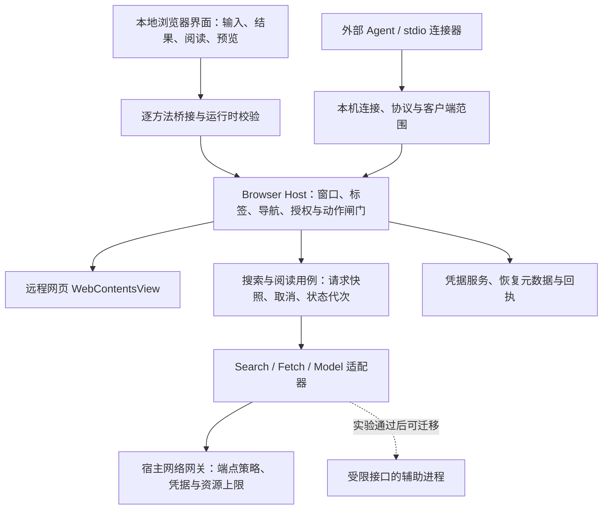

# 从 v0.1.0 到下一阶段：架构调查与验证计划

日期：2026-11-04。基线：`34f4f67` / `v0.1.0`。状态：文档与源码调查已完成；候选运行时的对照实验、真人任务及正式安全验收未完成。

服从 [主计划](../PLAN.md)。本文给出下一阶段的可逆设计建议及选择方法，不宣布最终内核、不改动 v0.1.0，也不以相关项目的宣传代替 Grid 实测。决策摘要见 [ADR 0002](./adr/0002-next-stage-architecture.md)。

后续实施更新（2026-11-04）：[请求/上下文切片](./SMOKE_REQUESTS_2026-11-04.md)和[窗口/标签内存状态切片](./SMOKE_TABS_2026-11-04.md)已有本机验证，覆盖 R2 的请求、每标签导航/位置与生命周期部分；下文源码问题保留为 v0.1.0 基线发现，R2 的持久恢复、R3–R6 及真人任务仍未完成。

## 1. 先确定什么值得优化

立项的核心是用户主动查找信息、连续理解来源，以及在同一浏览会话中可控地使用 Agent。架构应先让以下三条路径成立：

| 路径 | 必须保住的体验 | 需要观察的结果 |
|---|---|---|
| 搜索 → 场景阅读 → 原页 | 专业、学习、生活、娱乐、灵感由用户选择；可关闭改写；先有结果，提取按需发生；返回不丢问题和位置 | 相同问题下可用来源、原文依据、等待、回退和注意力；不能只数返回条数 |
| 编程工具 → 授权读取 → 多来源理解 | 无需搬 Cookie；知道哪个客户端读哪页；撤销确实生效 | 首次配置及首次成功读取的真人步骤和耗时，失败原因 |
| 提案 → 预览 → 确认/暂停/接管 | 浏览器界面说明来源、目标、内容和影响；页面变化后重新定位 | 人能否理解和拒绝；旧动作被拦截；已发出而无法确认的操作明确为未知 |

先用 [开发者试用任务](./DEVELOPER_PREVIEW_2026-11-04.md) 做探索性观察。3–5 名参与者可以发现问题，不足以证明普遍优势；保留个人结果、失败与样本量，小样本不以 P95 宣传性能。A/B 阅读仍待用户选择，研究不得先删除任一路线。

## 2. 现状与计划中的偏差

以下是源码检查，不是新增运行测试或漏洞利用结论：

| 观察 | 可检查位置 | 对下一阶段的影响 |
|---|---|---|
| 浏览器生命周期、服务请求、凭据、权限及 UI 状态集中在一个入口；一个全局网页视图和一组查询变量 | [main.ts](../prototypes/electron-m0/src/main.ts) 的 `createWindow`、`search`、`readPage` | 多标签/多窗口前，先明确状态归属和资源销毁；不能只复制 UI |
| 渲染器有请求计数，主进程等待 API 后仍直接改全局状态；取消没有贯通到 HTTP 请求 | [renderer.ts](../prototypes/electron-m0/src/renderer/renderer.ts)、[main.ts](../prototypes/electron-m0/src/main.ts) | 慢旧请求可能覆盖新上下文；需主进程请求代次检查和真正的取消信号 |
| 正文与全局 `lastQuery` 分开保存，场景也是可变全局选择 | [main.ts](../prototypes/electron-m0/src/main.ts) 的 `grid:extract` | 一次阅读/提取应绑定当时的查询、场景和正文快照，不能读取后来变化的全局值 |
| IPC 检查 UI 的 webContents ID，尚未核对 senderFrame 和可信来源；主/渲染器类型重复 | [main.ts](../prototypes/electron-m0/src/main.ts) 的 `assertUiSender`、[preload.ts](../prototypes/electron-m0/src/preload.ts) | 补主框架和来源验证、共享运行时 schema；保留每方法一个桥接入口 |
| 固定字段实验核对文档、节点身份和旧值，但不具备通用页面版本、人工输入栅栏或预览期限 | [form-action.ts](../prototypes/electron-m0/src/form-action.ts) | 保持只限本地夹具；不能外推到任意登录网站或框架表单 |
| 取消可能与已发出的填写脚本交错，当前取消状态不足以说明字段是否已经改变 | 同上 `confirm` / `cancel` | 区分未发送的取消与发送后的未知结果；停止后续步骤，再只读核对 |
| 打包后的 MCP 复用 Electron 可执行文件，并依赖 `ELECTRON_RUN_AS_NODE=1` | [main.ts](../prototypes/electron-m0/src/main.ts) 的配置导出、[打包脚本](../prototypes/electron-m0/scripts/package-mac.py) | 发布加固必须与连接器启动方式一起设计，不能直接关闭对应 fuse 后声称 MCP 仍可用 |
| 已有本机预览包、真实宿主提案、五场景实接口和 UI 回归；计划仍有“未实现动作/安装包”“不增加模式选择”等旧表述 | [预览记录](./DEVELOPER_PREVIEW_2026-11-04.md)、[宿主体验复核](./UX_HOST_FORMS_2026-11-03.md) | 更新完成范围；机器连通不等于质量、真人体验或独立安装通过 |

## 3. 从一手资料和相关项目学什么

核对日期为 2026-11-04。项目源码链接指向当日读取的 main/master，后续可能变化；这里只检查所列范围，没有安装比较、完整安全审计或维护成本测量。

| 来源与检查范围 | 已观察到的做法 | Grid 的取舍建议 |
|---|---|---|
| [Electron 进程模型](https://www.electronjs.org/docs/latest/tutorial/process-model)与 [WebContentsView](https://www.electronjs.org/docs/latest/api/web-contents-view) | 主进程拥有应用生命周期；网页视图和辅助进程有不同职责 | 主进程拥有标签、导航和授权；视图只是呈现载体，标签状态必须自己建模 |
| [Electron 安全建议](https://www.electronjs.org/docs/latest/tutorial/security)与 [contextIsolation](https://www.electronjs.org/docs/latest/tutorial/context-isolation) | 处理任意不可信网页有额外风险；隔离上下文不替代 IPC 权限检查 | 保留网页禁 Node、沙箱和隔离；核对 IPC 调用框架/来源及参数；不用通用脚本或 IPC 转发作为能力接口 |
| [Min 仓库](https://github.com/minbrowser/min)及 [main/main.js](https://raw.githubusercontent.com/minbrowser/min/master/main/main.js) | Electron 浏览器入口显式管理窗口集合、窗口状态恢复及生命周期 | 参考资源与窗口的归属；不照搬其本地应用视图的 Node/隔离设置，也不据此认定 Grid 已继承浏览器基本功 |
| [BrowserOS 仓库](https://github.com/browseros-ai/BrowserOS)及 [浏览器包说明](https://raw.githubusercontent.com/browseros-ai/BrowserOS/main/packages/browseros/README.md) | 浏览器 fork 与 Agent 子系统分开；浏览器侧还需补丁、构建、签名与更新流程 | 学习浏览器执行权和智能服务分层，以及 fork 的完整维护面；不因对方用了 Chromium/Rust 就照选，也不直接搬入其 AGPL 代码 |
| [MCP tools 规范（2025-06-18）](https://modelcontextprotocol.io/specification/2025-06-18/server/tools) | 规范要求工具输入和访问控制；工具标注本身不能被无条件信任，建议用户可见并能拒绝调用 | MCP 只翻译能力请求；读取授权、提案与执行确认在 Grid 内分别验证；协议兼容版本随 SDK 实测记录 |
| [utilityProcess API](https://www.electronjs.org/docs/latest/api/utility-process) | 支持 Node 辅助进程；环境默认可继承，session 选项可使用指定浏览会话网络 | 可研究崩溃隔离；它不是自动获得的 OS 权限沙箱。显式裁剪环境，不给模型 worker 真实资料档 session、Cookie 或浏览器控制句柄 |
| [Electron fuses](https://www.electronjs.org/docs/latest/tutorial/fuses) | 禁用 RunAsNode 会阻止对应环境变量启动路径 | 先做独立连接器/固定 stdio 角色实验，再决定发布 fuses；应用内部 worker 和外部宿主启动 MCP 是两件事 |
| [Electron 签名](https://www.electronjs.org/docs/latest/tutorial/code-signing)与 [更新](https://www.electronjs.org/docs/latest/tutorial/updates) | 官方提供 Forge 对签名、公证及更新的集成路线 | 正式分发优先做官方工具链的小实验，保留现有预览；验证升级、凭据和配置迁移，不自建完整更新协议 |
| [CEF 官方仓库](https://github.com/chromiumembedded/cef)及 [General Usage](https://chromiumembedded.github.io/cef/general_usage) | 提供原生嵌入、浏览器/框架及多进程集成接口 | 作为 Electron 出现硬性能力缺口时的原生候选；嵌入框架不会自动补齐完整浏览器产品 |
| [Tauri WebView 说明](https://v2.tauri.app/reference/webview-versions/) | 各平台使用的 WebView 及更新来源不同，macOS 使用 WKWebView | 不假设三平台有同一 Chromium 能力；系统 WebView 保留比较资格，冻结历史样机不是判定它没有 DOM 能力 |

Chromium 的更新节奏必须按当期官方记录核对，不能沿用旧的固定周期假设；fork 的判断依据是一次真实更新演练，而非“能编译一次”。[Chromium 发布周期](https://chromium.googlesource.com/chromium/src/+/main/docs/process/release_cycle.md)

## 4. 候选路线及选择方法

先列硬约束，再比较成本；没有同任务数据前不编造加权总分。

| 路线 | 解决什么 | 尚需承担/验证 | 当前安排 |
|---|---|---|---|
| A：现有 Electron + TypeScript 渐进模块化 | 利用 v0.1.0 实测资产继续验证搜索、阅读和受控 Agent | 浏览器基本功、IPC、权限、更新和日用站点兼容；正式安全能力仍未证明 | **推荐作为下一阶段实验载体**，不宣布终局 |
| B：CEF 原生宿主 | 若 A 的嵌入或宿主 API 无法满足硬约束，研究原生实现 | 原生 UI、系统集成、分发、浏览器能力和维护成本；需实际纵向切片 | 有明确阻断项后才与 A 做同任务比较 |
| C：Chromium 薄补丁 fork | 若确需修改浏览器内部能力，研究直接控制内核 | 补丁冲突、安全跟进、跨平台构建、签名更新、维护人员及备援 | 通过 G1 和独立 ADR 才实施；不重启大规模下载来替代决策 |
| D：系统 WebView 原生壳/Tauri | 研究系统集成与维护方式是否更适合目标任务 | 目标站点、自动化、媒体、扩展和平台差异；性能不能靠旧 PoC 推断 | 历史 WebKit 保持冻结；只有新证据才重开 |
| E：惯用浏览器 + 现有工具/扩展 | 衡量 Grid 是否确实减少搜索、搬运和连接负担 | 不完整满足独立浏览器目标；扩展方案的权限与分发需另查 | 用户任务的对照基线，不默认为产品转向 |

只有实测表明 A 被必需能力阻断，才用同一负载实现 B 或 C 的最小验证；不同时做五套浏览器。若主要问题是检索质量或流程不清楚，先修该层，换内核不能代替它。

## 5. 推荐的下一阶段设计

采用**同一仓库、TypeScript 模块化应用、少量清晰权限边界**。先独立接口和状态，再决定哪些模块需要独立进程；不把多语言、微服务、全量事件溯源或新 UI 框架当作成熟度标志。

实线表示拟实施的调用边界，不表示这些模块已经独立实现；辅助进程是可选实验。网页和服务返回值是数据，不能从图中反向取得授权或执行权。代码依赖遵循：纯用例依赖契约/端口，Electron 和提供者实现这些端口，由入口组合注入；纯业务模块不导入 Electron，不形成 Host/用例的循环导入。

### 5.1 状态和接口

- `WindowRegistry` / `TabRegistry` 拥有网页实例及销毁；`NavigationStore` 保存每标签的原页、结果、阅读入口。界面订阅带 revision 的快照，旧事件不覆盖新状态。
- `SearchRun` 固定原问题、实际查询、场景、提供者、请求 ID、所属标签与代次；`ReadingDocument` 固定来源 URL、获取时间、获取方式、正文、截断标记及所关联的查询。提取是单独的 `ExtractionRun`，引用正文版本和本次显式选择的场景。
- 取消在主进程用例层传到适配器/网络请求；响应完成时再检查所属窗口、标签、运行 ID 和代次。仅在 renderer 丢弃旧响应不够。取消不能承诺服务端停止计费或处理，但应停止本地消费和旧状态写入。
- `SearchProvider`、`FetchProvider`、`ModelProvider` 分开；先适配当前 DeepSeek，再以第二个实际来源验证接口。五场景属于可检查的查询/提取策略，不等于五套后端或画像。
- 共享 `contracts/` 使用现有 schema 工具做输入与输出校验、错误码和协议版本；限制响应字节数、解析工作量、时间和并发。TypeScript 类型断言不能替代运行时检查。
- 阅读/动作回执默认只保留必要元数据；提供者错误和 UI 错误分别归类。凭据由宿主保存；用户在本地设置输入后清空，不返回给远程页面或 MCP。

### 5.2 动作边界

读取授权、创建提案、确认执行是不同能力。外部客户端和模型可以提出计划，不能自行消费“人已确认”的凭证。目标至少绑定连接/任务、profile/tab/frame/document、目标引用、目标相关版本、输入栅栏及短时有效期。实际来源由宿主解析，不能信任客户端自报的 URL。

本机管道令牌证明持有连接凭据，不证明客户端自报名称是真实应用身份；同一用户恶意进程仍属剩余风险。当前 loopback 主机名与 `/actions.html` 白名单也只是实验范围限制，不认证页面发布者。正式扩大范围前要明确攻击者、跨来源框架和凭据读取边界，不能把“在本机”当作信任根。

页面版本不是每次动画都递增的全页 DOM 计数。需要导航 epoch、目标是否替换/变值/隐藏、人工输入 epoch 等有意义的失效条件；SPA 同文档导航、iframe 和焦点变化如何影响授权，由实验明确。固定节点旧值检查是起点，不是完整并发保证。

执行前复核，发送后观察。未发送时可确定取消；发送后发生接管、超时、导航或进程退出，无法确认结果则为 `unknown`，停止后续动作并只读核对，不自动重试写操作。已完成的单次同步写入不能被“暂停”倒转。通用输入事件和框架控件可能触发站点副作用，不能因为没有点提交就一律当作可撤销动作。

### 5.3 进程、存储与分发

网络适配先采用异步、有取消和大小上限的接口；若解析、模型 SDK 或故障影响浏览，再用同接口做辅助进程实验。建议凭据注入与提供者 HTTP 出站集中在宿主网关，worker 只提交符合端点/数据范围策略的请求，不传入任意 URL，也不直接控制 WebContents、接收真实浏览会话或整份环境变量。若 SDK 必须自行联网/持有 key，先记录边界变化再决定是否采用。Node 辅助进程保留的文件/网络能力必须如实列出；网关只控制经它发出的请求，若要求约束被攻陷 worker 的全部出站，需要另外的 OS 隔离与攻击测试。

偏好和最小恢复元数据先用版本化、原子写入文件；跨多条记录查询、历史和迁移需求成立后再引入 SQLite。网页正文不默认落盘；内容缓存、历史元数据、凭据和执行回执分开。恢复仅重建用户选择的标签/位置，所有旧授权与执行凭证作废；未知动作不能恢复自动执行。使用同一用户资料档时，单实例或显式多进程协调必须先确定。

需要跨崩溃追踪的写动作，在发送前先持久化最小执行记录（动作 ID、脱敏来源/目标及阶段，不含输入值），落盘失败不发送；完成观察后再终结。重启时任何未终结记录进入 unknown，不靠内存回执推测结果。这是有界执行日志，不要求把所有 UI 事件持久化；尚未实现前不承诺写动作的崩溃恢复。

打包 MCP 比较两种方式：应用可执行文件的固定 `--mcp-stdio` 角色（不创建 UI、不接受任意脚本路径、仅代理受限桥接），或独立签名连接器/运行时。两者都需测启动、双实例、路径移动、崩溃和升级；保留现有预览路径直到替代方案通过。应用内部 `utilityProcess` 本身不解决外部客户端如何启动 stdio。正式发行再完成 Forge 工具链、稳定应用身份、Developer ID/公证及 N→N+1 升级演练；当前 ad-hoc 包不改称正式安装验证。

### 5.4 UI 品味落实为工程约束

沿用 [现有设计依据](./DESIGN_PRACTICES_2026-11-04.md) 的系统字体、中性色、语义强调色、浅深色与减少动效。场景色表达用户选择，不承担唯一状态信息。拆分搜索、阅读、授权、动作视图与状态更新；只有具体维护问题成立时才评估新组件框架。

每个架构切片都验收用户路径：新请求不清空旧结果；来源和原文不会被 AI 内容替代；返回恢复位置；出错后主动作仍可用；预览确认/暂停在矮窗口可见；键盘焦点可预测。连接器等待与模型等待分开反馈，不把底层协议和调试词推给用户。

## 6. 调查和实施的出口

以下为后续工作，不是本轮通过项；顺序表达依赖，不承诺未经估计的日期。用户观察与确定性工程实验可并行。

| 工作包 | 最小实验与产物 | 通过后才能做什么 |
|---|---|---|
| R0：目标/现状对齐（本轮） | 修正文档矛盾；记录代码位置、证据边界、候选及 ADR 草案 | 开始按共同约束实施，不改称 M0/G1 完成 |
| R1：用户与搜索基线 | 三项代表任务；优先用户已选的搜索/场景提取；同题原样/场景、A/B、Fetch 拒绝和原页回退；人工核对依据与漏检 | 决定体验优先级；A/B 最终选择仍由用户确认 |
| R2：生命周期与并发 | 先保留单页，模拟慢旧搜索、新查询、切场景、读页中返回、窗口关闭/重开、崩溃；记录主进程及 UI 最终状态 | 共享契约、用例状态和取消贯通后，再建每标签导航及多窗口 |
| R3：能力与动作约束 | 先在本地夹具重现发送后取消；测试节点替换、人工输入、同文档导航、iframe、撤权、超时和崩溃；记录 unknown/对账 | 决定可开放动作范围；未通过继续仅本地固定字段 |
| R4：可替换服务与故障隔离 | 第二个真实检索源合约、响应超限/格式错误/取消；用相同用例比较进程内与辅助进程的退出/超时 | 决定是否分进程、缓存及重试；不凭源码分层推断安全隔离 |
| R5：安装与浏览器基础 | 最小多标签/历史后，在实际包测登录、下载、媒体、PDF、会议/Passkey 等任务驱动清单；连接器/fuse 实验；两台机器安装与升级、凭据/配置迁移 | 可说明哪些日用任务可支持；签名账号等外部依赖须列明 |
| R6：G1 选择 | 汇总用户收益、不可绕过的能力缺口、全进程树同负载数据、发布成本、维护责任与更新演练 | 确认继续 Electron；或针对已证实阻断项比较 CEF/fork 并另作 ADR |

实施拆分建议：第一份代码改动只做共享契约、请求快照/取消及主进程状态回归；第二份做标签/导航和生命周期；动作状态、服务替换和打包各自成可复验切片。每次保留可运行应用、原有测试与回退，不把大规模搬目录当成交付。

## 7. 还不能决定的内容

最终内核、是否需要 Rust/原生 Broker、A/B 默认阅读路线、通用网页写权限、生产缓存期限与 Search/Fetch 内容分发权、公共 relay 和扩展生态均没有被本调查批准。UI 优化继续以任务理解和操作负担为证据；既有截图自评不能作为审美或无障碍验收结论。

研究结论是下一步的可证伪假设：**先用已有 Electron/TypeScript 资产建立明确状态与权限边界，靠少量纵向实验决定进程和内核；每个决定都说明它解决了哪一个已观察到的问题。**
